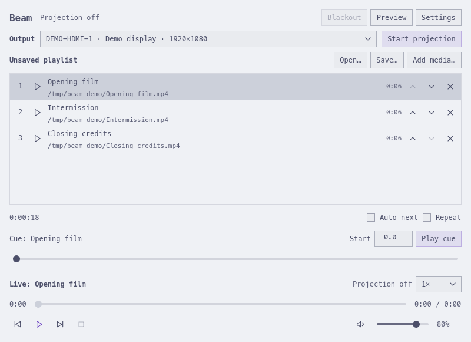
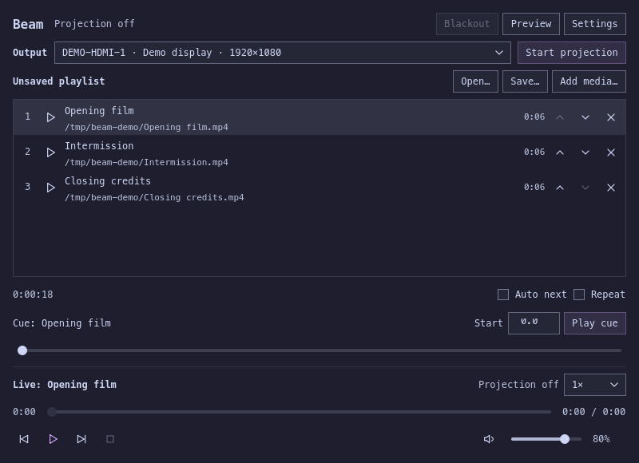

# Beam

| Light theme | Dark theme |
| --- | --- |
|  |  |

A compact Qt Quick controller for projecting mpv video fullscreen on a display you choose. Prepare the next cue privately while the audience watches the current video. Beam follows Omarchy's live palette and monospace shell font, with square 28px controls.

1. Add local videos with **Add media**, drag and drop, or `beam file.mp4`.
2. Choose the output connector and **Start projection**. It opens standby; choose a standby image in Settings if desired.
3. Click a row to prepare its cue, scrub the private cue position or enter a start time in seconds. **Play cue** switches the audience output. A row's play icon also starts that row explicitly.
4. **Pause** holds the frame, **Stop** returns to standby, and **End projection** closes the output. EOF returns to standby unless **Auto next** is enabled. Repeat wraps the queue.

Selecting or editing a cue never redirects live transport or MPRIS. Queue entries have independent IDs, even for duplicate paths; drag a row number to reorder, or use its move arrows. Missing files can be relinked in Settings.

## Preview, blackout and presentation

**Preview** shows the current output state and an independently labeled private cue image. Live frames are sampled from the audience mpv process approximately every 700ms, including the paused frame; this is a confidence monitor, not frame-accurate synchronization. Private frames are decoded once with ffmpeg and no audio. Hiding preview stops its timer and decoder. Capture errors show an unavailable state, never an old frame labeled live.

**Blackout** (`B`) masks the audience picture, including subtitles, while preserving playback position and playing/paused intent. Settings chooses whether audio continues. Master mute/volume changes made during blackout remain in effect afterward. Blackout stays engaged through Stop, EOF, Next and new cues until explicitly cleared; End projection clears it.

Settings lists audio devices by their mpv identity, with **System default** and an explicit unavailable state for a disconnected saved device. Select a device to apply it and save the choice. A missing saved device uses the system default until it returns or you choose another device.

Cue settings include embedded audio and subtitle tracks, subtitles off, original aspect (default), fill/crop, or explicit 4:3 / 16:9 aspect. Reset restores defaults. These settings take effect on the next explicit play of that item, even if the same entry is currently live. Missing embedded tracks fall back to automatic audio / subtitles off.

Per-item volume is an absolute 0–100 override; **Inherit master volume** is the default. The master slider and MPRIS Volume always control the saved master level. An item override takes precedence until that item ends; master mute always applies to every item. The override never changes the master value or leaks into the next item's inherited volume.

## Save and exchange playlists

**Save** writes a named `.beam` JSON playlist (format `beam-playlist`, version 2) atomically. It stores order, stable IDs, absolute local paths, cue positions, track selections, aspect and item volume. Session recovery is also saved automatically. Opening another playlist requires saving or explicitly discarding unsaved edits.

Open/import local `.m3u` or `.m3u8` playlists with UTF-8 paths; relative paths resolve against that playlist's directory. Settings exports relative UTF-8 M3U8. Order and duplicate paths survive exchange. M3U cannot carry Beam IDs, start positions, aspect, tracks or volume, so those settings reset on import. Remote URLs are rejected. Duration probes run one at a time asynchronously; totals distinguish known duration from unknown items.

## Install and build

```sh
git clone https://github.com/jeancarlosg93/beam.git
cd beam
bin/build
bin/test
bin/install --user
```

User installation puts the executable in `~/.local/bin/beam` and a launcher entry under `~/.local/share/applications/`. Open **Beam** with the Omarchy launcher. `bin/install` instead builds and installs a versioned Arch package with makepkg and administrator authentication. Re-run the same install command to update.

Build: a C++17 compiler, make, Qt 6 base/declarative, Wayland and SVG packages. Runtime: mpv **0.38+**, ffmpeg (including ffprobe), and xdg-desktop-portal with a file chooser backend. Tests also use dbus-run-session, gdbus (glib2), and Python 3. Setup uses Python 3 and hyprctl. Arch releases use makepkg/fakeroot. No libmpv headers are needed.

`beam check show.beam --json` checks a playlist without opening a window and returns 0 when all local media are readable. `beam convert show.m3u8 show.beam --json` converts playlists without a display (use a `.m3u8` output to export paths). Both return structured JSON and errors on stderr; conversion preserves missing entries for later relinking.

`bin/release` prepares source/package/checksum artifacts locally after build/tests. See [release notes](docs/release-0.2.0.md) and the [implementation and verification record](docs/specs/beam-0.2-status.md). GitHub CI builds and runs the behavioral suite on Arch Linux.

## Display setup

Output is selected by stable connector name with readable monitor details. **Identify displays** shows temporary numbered overlays (five seconds; Escape or click dismisses). Start projection, then invoke **Test pattern** in Settings to check framing, aspect and colors; **Return to standby** ends testing. Test pattern refuses to replace live playback. Disconnecting the selected output closes projection and preserves its identity; reconnect and explicitly restart, or choose another display. Beam never silently moves live output to a different connector.

For Beam-only no-dimming and keep-awake rules on current Omarchy/Hyprland Lua:

```sh
bin/install --setup-output
```

This opt-in action backs up `~/.config/hypr/looknfeel.lua`, preserves unrelated settings, adds only the `^beam-output$` rule, and checks `hyprctl reload` / `configerrors`. Validation failure rolls back. Repeating it is safe. Ordinary installation does not change desktop configuration. The output's idle inhibitor remains active during pause/standby and ends when projection closes. Current rule syntax: [Hyprland window rules](https://wiki.hypr.land/configuring/core/rules/window-rules/).

The audience process has a private IPC socket, `--no-config`, no controls/OSD or keyboard bindings. Personal mpv scripts cannot affect the clean output. Original media are never modified.

## System media controls and shortcuts

Beam implements [MPRIS](https://specifications.freedesktop.org/mpris/latest/) under `org.mpris.MediaPlayer2.beam` (additional instances use a PID suffix). Omarchy's normal media keys control the shell's selected player. MPRIS always describes the active item while it exists; private cue inspection never creates another media service. System Next/Previous preserve playing, paused or stopped intent. Row play and Play cue explicitly start playback.

| Key | Action |
| --- | --- |
| Space | Play / pause |
| B | Toggle blackout |
| S or Escape | Stop to standby; Escape also dismisses display identification |
| Left / Right | Seek backward / forward 5 seconds |
| Ctrl + Left / Right | Play previous / next video |
| M | Mute / unmute |
| Ctrl + O | Add media |
| ? | Show shortcuts |
| Q | Quit and close projection |

## State, language and verification

Session data is written atomically to `~/.local/share/beam/session.json`. Existing 0.1 sessions migrate without changing their file order. Omarchy language changes reload live; English and Danish catalogs cover the interface, with English fallback for other languages.

`bin/test` uses generated media, a private session bus and headless mpv to verify cue/live separation, identities, persistence/migration, device/track/aspect/volume settings, blackout, preview cleanup, display recovery, MPRIS and actual QML keyboard/mouse reorder. It also verifies safe setup against temporary configurations. Physical multi-monitor placement and speaker routing require hardware checks, detailed in the status record.

For isolated QA, `BEAM_STATE_FILE`, `BEAM_LANGUAGE_FILE` and `BEAM_THEME_DIRECTORY` override source paths. `BEAM_CAPTURE=/absolute/file.png` captures the controller and exits; `BEAM_CAPTURE_COMPACT=1`, `BEAM_CAPTURE_PREVIEW=1` and `BEAM_CAPTURE_SETTINGS=1` select QA states. Screenshots contain synthetic demonstration media only.

Licensed under MIT. Theme/language infrastructure is adapted from Omarchy app templates (Omacut / Monologue, David Heinemeier Hansson).
