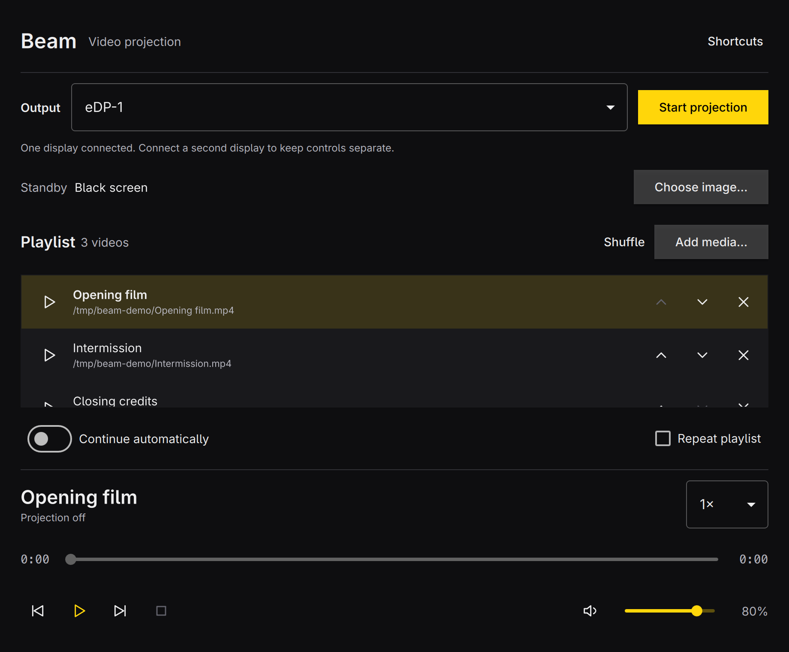

# Beam

A Qt Quick playlist controller for projecting mpv video fullscreen on a display you choose. The operator window stays separate from the output. It follows Omarchy's accent and Hyprland window rounding live.

1. Add videos with **Add media**, drag and drop, or `beam file.mp4`.
2. Select the output display and choose **Start projection**. Standby is black by default; use **Choose image** for a custom still image.
3. Play a video using its row's play button. Videos stop at the end and return to standby. Use **Next** to cue the following video. Enable **Continue automatically** for continuous playback.

**Pause** holds the video frame. **Stop** returns to standby. **End projection** closes the output window and enables display selection again. The playlist, standby image, output choice, volume, repeat and continuation settings are restored next time. Original media files are never modified. Audio uses the system's default output; change the audio destination in Omarchy's sound settings if necessary.

The selected item stays selected after it finishes; Play starts it again. Previous/Next play their target immediately. Repeat wraps Next, and wraps automatic playback when continuation is enabled.

## Install and build

```sh
bin/build
bin/test
bin/install --user
```

User installation puts the binary in `~/.local/bin/beam` and the launcher entry under `~/.local/share/applications/`. Open **Beam** from `Super + Space`.

For a system package, `bin/install` runs `makepkg -fsi` and needs administrator authentication. A built package is in `pkgbuild/beam-0.1.0-1-x86_64.pkg.tar.zst`.

Build dependencies: Qt 6 base, declarative, Wayland, SVG, a C++17 compiler and make. Runtime: mpv and xdg-desktop-portal with an active file chooser backend. Tests also need ffmpeg. No libmpv development package is needed.

The app starts a dedicated mpv process with its own private IPC socket and `--no-config`, so personal mpv bindings/scripts cannot affect the clean projection output. Output is selected by connector name, using mpv's `screen-name` and `fs-screen-name` options. Disconnecting the selected output ends projection. Switch display targets by ending and restarting projection.

## Shortcuts

| Key | Action |
| --- | --- |
| Space | Play / pause |
| S or Escape | Stop to standby |
| Left / Right | Seek backward / forward 5 seconds |
| Ctrl + Left / Right | Play previous / next video |
| M | Mute / unmute |
| Ctrl + O | Add media |
| ? | Show shortcuts |
| Q | Quit and close projection |

## State, language and verification

Session data is saved atomically to the Qt application data directory (normally `~/.local/share/beam/session.json`). Missing files remain in the queue and show an error when played. Omarchy's language file is watched live; English and Danish interface catalogs are included, with English fallback for untranslated strings and other languages. No Omarchy configuration is changed.

`bin/test` exercises session recovery, playlist ordering, actual mpv playback/pause/seek/speed/volume/mute, standby after EOF, continuous repeat, shutdown/restart, theme/translation parsing and real Qt Quick keyboard interaction. `BEAM_LIVE_TEST=1 build/tests/beam_tests qmlInteraction` runs the interaction check on the active Wayland session. The external display workflow still needs physical verification with a second monitor; development was done with only eDP-1 connected.

For isolated QA, `BEAM_STATE_FILE`, `BEAM_LANGUAGE_FILE` and `BEAM_THEME_DIRECTORY` override source paths. `BEAM_CAPTURE=/absolute/file.png` captures the controller after initial rendering and exits; `BEAM_CAPTURE_COMPACT=1` requests the minimum size. Demo screenshots use synthetic files under `/tmp/beam-demo`; these are not installed or added to your real playlist.

Licensed under MIT. Theme and language infrastructure is adapted from the Omarchy app templates (Omacut / Monologue, David Heinemeier Hansson).
